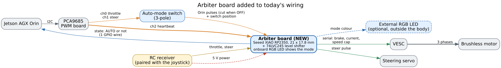
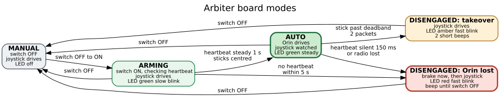
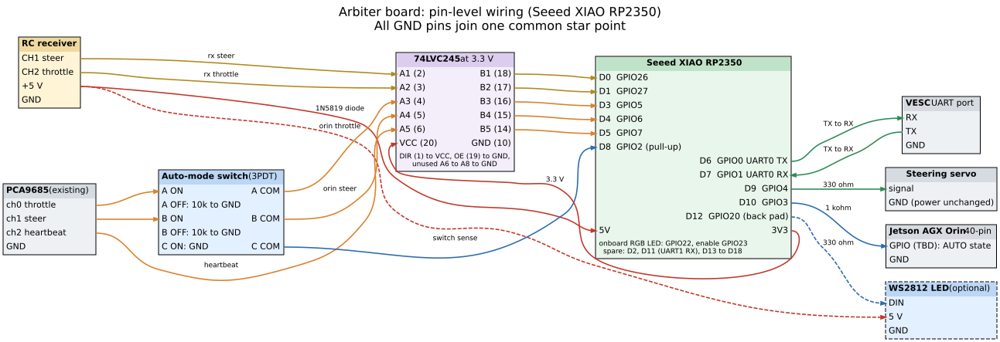

# RC override arbiter: the joystick as a kill switch

Status: design, not built. No board has been bought and no firmware or
vehicle-side code exists yet.

A small board between the two command sources and the actuators decides who
drives. The remote joystick can always take the vehicle; the Orin drives only
while the auto-mode switch is ON, its heartbeat is alive and nobody has touched
the joystick. Any of those failing latches the board out of autonomous mode
until a person switches OFF and ON again.

## Why the vehicle needs it

Today a physical selector switch picks the Orin path or the joystick path for
the throttle and steering signal wires. Nothing arbitrates between them, and
three failures go unnoticed:

- **A dead Orin keeps driving.** The PCA9685 generates its pulses on its own
  and holds the last pulse width forever after the last I2C write. If the Orin
  hangs, crashes or loses I2C, the VESC keeps receiving the last throttle, and
  its own timeout never fires because pulses keep arriving.
- **A silent Autoware keeps driving.** `actuator.py` stores the latest control
  command in `control_callback` and its 100 Hz `timer_callback` drives toward
  it without checking its age.
- **The remote driver cannot take over** while the selector points at the
  Orin; someone has to reach the vehicle and flip it.


## What changes

One board is added, the selector switch is rewired as an auto-mode switch, and
the Orin gains a heartbeat on a spare PCA9685 channel. The motor, ESC, servo,
receiver and PCA9685 stay as they are.



| Part | Change |
|---|---|
| Arbiter board | new: Seeed XIAO RP2350 and a 74LVC245 on a small carrier |
| Selector switch | becomes the auto-mode switch, a 3PDT toggle |
| PCA9685 ch2 | new heartbeat output, written by the actuator node |
| VESC | input app changes from PPM to UART; timeout and brake current set |
| Orin | reads one GPIO line that says whether it is in control |
| External RGB LED | optional, if the onboard LED is not visible from outside |

## Modes

The board has five modes. Both disengaged modes are latched: the only way back
to AUTO is the auto-mode switch going OFF and then ON.



| Mode | Who drives | LED |
|---|---|---|
| MANUAL (switch OFF) | joystick | off |
| ARMING (switch just turned ON) | joystick | green, 1 Hz blink |
| AUTO | Orin, joystick watched | green, steady |
| DISENGAGED: takeover | joystick | amber, 4 Hz blink |
| DISENGAGED: Orin lost | brake first, then joystick | red, 4 Hz blink alternating with full brightness |

"Disengaged" is the term AV testing uses for autonomous control ending, whether
the safety driver took over or the system failed, which is why one mode covers
both causes. The two look different on the LED because one was chosen and the
other was not.

Transitions:

- **MANUAL to ARMING:** the switch goes OFF to ON. A board that powers up with
  the switch already ON stays in MANUAL until it sees a real OFF to ON, so a
  reset or brown-out cannot re-enter AUTO by itself. The switch is debounced
  for 50 ms.
- **ARMING to AUTO:** 1 s of steady heartbeat with both sticks centred, so the
  vehicle does not jump when the switch flips.
- **ARMING to DISENGAGED (Orin lost):** no heartbeat within 5 s, so a forgotten
  Orin start is not silent.
- **AUTO to DISENGAGED (takeover):** either stick past its deadband for two
  consecutive receiver frames.
- **AUTO to DISENGAGED (Orin lost):** the heartbeat has not toggled for 150 ms,
  or the radio link is lost. Without a radio nobody can take over, so the
  vehicle stops rather than keep driving autonomously.
- **Any mode to MANUAL:** the switch goes OFF.

In DISENGAGED (Orin lost) the board commands the VESC to brake at once and
holds the brake while the joystick throttle sits at neutral. Steering passes
through immediately; throttle passes through as soon as the driver moves it.
Radio loss in MANUAL or after a takeover also brakes.

## Heartbeat

The actuator node toggles PCA9685 ch2 between 1.2 ms and 1.8 ms pulses on every
fifth tick of its 100 Hz loop (a 20 Hz toggle, each state held for three 60 Hz
frames), and only while the latest control command is younger than 200 ms.

The heartbeat rides on the PCA9685 rather than a separate GPIO or serial line
because one signal then proves the whole chain at once: Autoware publishing, the
actuator node running, I2C working and the PCA9685 responding. A thread that
toggled a GPIO would stay alive with Autoware or I2C stuck.

The board declares the Orin lost after 150 ms without a toggle, that is three
missed toggles. Worst case from Autoware going silent to brake is about 350 ms
(200 ms command age plus 150 ms).

The same command-age check belongs in `actuator.py` independently of the board:
the node should command neutral throttle on a stale command instead of driving
on the last one.

## Wiring



The same wiring as a harness drawing, with every wire and part listed, is
[`wiring.svg`](assets/rc-override-arbiter/wiring.svg), generated with WireViz
from [`wiring.yml`](assets/rc-override-arbiter/wiring.yml); it is wide, so
zoom in.

| XIAO pin | GPIO | Signal | Through |
|---|---|---|---|
| D0 | 26 | receiver steer in | 74LVC245 A1 to B1 |
| D1 | 27 | receiver throttle in | A2 to B2 |
| D3 | 5 | Orin throttle in, PCA ch0 | switch pole A, then A3 to B3 |
| D4 | 6 | Orin steer in, PCA ch1 | switch pole B, then A4 to B4 |
| D5 | 7 | Orin heartbeat in, PCA ch2 | A5 to B5 |
| D8 | 2 | auto-mode switch sense, internal pull-up, low = ON | switch pole C to GND |
| D6 | 0 | UART0 TX to VESC RX | |
| D7 | 1 | UART0 RX from VESC TX | |
| D9 | 4 | steering servo out | 330 ohm |
| D10 | 3 | AUTO state to an Orin 40-pin GPIO | 1 kohm |
| D12 (back pad) | 20 | external LED data, optional | 330 ohm |
| 5V | | power from the receiver 5 V rail | 1N5819 Schottky |
| 3V3 | | 74LVC245 supply | |

Spare: D2 (GPIO28) on the edge; D11 (GPIO21, UART1 RX) reserved for a serial
receiver; D13 to D18 on the back pads. The onboard RGB LED is GPIO22 with its
power enable on GPIO23. Pin numbers are from the arduino-pico board definition
for the XIAO RP2350.

Notes on the wiring:

- **The switch cuts the Orin in hardware.** Poles A and B carry the Orin
  throttle and steer; their commons go to the level shifter and their OFF
  throws to GND through 10 kohm, so with the switch OFF nothing from the Orin
  reaches the board and its inputs do not float. Pole C only reports the
  position. The heartbeat does not pass through the switch.
- **Every input is level shifted.** The RP2350 pins are 3.3 V and not 5 V
  tolerant. The PCA9685 outputs 5 V when its logic runs at 5 V, and some
  receivers do too. The 74LVC245 runs at 3.3 V and accepts 5 V inputs, so it
  covers both cases; tie DIR to VCC, OE to GND, and the unused A6 to A8 to GND.
- **The VESC is commanded over UART.** The board is the only device that
  commands it, translating both the Orin's and the joystick's pulses into brake,
  current and speed-limit commands. The servo still takes a pulse.
- **One common ground** for the receiver, PCA9685, board, VESC signal, servo
  and Orin header.
- **Power** comes from the receiver's 5 V rail through the diode, about 4.7 V at
  the XIAO 5V pin; the board draws tens of mA. If the servo rail runs above
  5.5 V, a 5 V regulator goes in front of the diode.

## Board choice

| Board | Size | GPIO | LED | Verdict |
|---|---|---|---|---|
| Arduino Nano (ATmega328P) | 45 x 18 mm | 20, 5 V | 1 | no: one UART, shared with USB |
| Seeed XIAO RP2040 | 21 x 17.8 mm | 11 | RGB | too few pins once LED and heartbeat are added |
| Cytron Maker Nano RP2040 | 49.6 x 21.1 mm | 22 | 2 RGB, buzzer | fits; no Taiwanese seller found |
| Raspberry Pi Pico | 51 x 21 mm | 26 | 1 | fits; large |
| **Seeed XIAO RP2350** | **21 x 17.8 mm** | **19** | **RGB** | **chosen**: small, onboard RGB LED, sold by icshop.com.tw (NT$295) |

The RP2350 has two Cortex-M33 cores at 150 MHz, 520 KB SRAM, two UARTs and
twelve PIO state machines. The PIO measures the five input pulses to 1 us
without the CPU, one core runs only the arbitration loop at 1 kHz, and the
hardware watchdog covers a hung firmware. CPU load is well under 1 %. The link
that needs care is the VESC UART: a 10-byte command at 500 Hz takes 43 % of
115200 baud, so telemetry for odometry needs a higher baud rate.

## Configuration outside the board

- **VESC Tool, App Settings:** app to use = UART; timeout 50 ms (default 1000
  ms); timeout brake current above 0 A (the default 0 A coasts); throttle ramp
  for slowing down set to 0. Set `max-speed` from the wheel diameter, gear
  ratio and motor poles, and store the Orin-mode cap (about 15 km/h) as the
  default; the board raises it only while the joystick drives, so after any
  reset the vehicle starts capped.
- **Receiver:** failsafe set to no pulses, or to neutral throttle.
- **Orin:** the vehicle interface reads the state line and reports MANUAL on
  `control_mode` whenever it is low, so the PID stops integrating while the Orin
  is not in control.

## Response time

With the joystick on a 50 Hz pulse receiver, from stick movement to the VESC
receiving the new command:

| Stage | Time |
|---|---|
| Radio link | 10 to 30 ms, depends on the radio |
| Receiver output frame | up to 20 ms |
| Takeover confirmation, two frames | 40 ms |
| UART command to the VESC | under 1 ms |
| **Total** | **about 50 to 90 ms** |

At 40 km/h (11.1 m/s) that is 0.6 to 1.0 m. A receiver with serial output (CRSF
or SBUS) on D11 and a high-rate radio link bring it to about 10 ms. The speed
cap matters more than either: braking distance from 40 km/h is about 9 m at
0.7 g, from 15 km/h about 1.3 m.

| Failure | Time to brake |
|---|---|
| Auto-mode switch turned OFF | immediate in hardware; joystick in control within one frame |
| Orin, actuator node or I2C dies | 150 ms |
| Autoware stops publishing | about 350 ms |
| Board firmware hangs | watchdog, then no commands; the VESC brakes on its 50 ms timeout |
| Radio lost | receiver failsafe, then brake |

## Odometry from the VESC

The VESC reports signed electrical RPM even with a sensorless motor, which is
how F1TENTH cars get odometry (the ROS 2 `vesc` driver and `vesc_to_odom`, one
`speed_to_erpm_gain` fitted over a measured run). It is signed, finer than the
KY-003 hall sensor and stays valid during a takeover. It is unreliable near
standstill, misses wheel slip, and its steering comes from the commanded angle,
which is wrong while the joystick drives. Reading it would go through the
arbiter's UART link or a separate USB connection to the Orin, read-only either
way.

## Open items

- [ ] Transmitter and receiver model: decides pulse or serial input and whether
      the receiver outputs 5 V.
- [ ] Servo rail voltage: whether the 5 V input needs a regulator.
- [ ] Orin 40-pin header pin for the state line.
- [ ] XIAO RP2350 5V pin input range, from its schematic.
- [ ] Bench test: a logic analyzer on the receiver output and the board's
      outputs, to measure the takeover latency against the table above.
- [ ] Vehicle side: heartbeat on PCA9685 ch2, the command-age check in
      `actuator.py`, and the state line in the vehicle interface.

## Regenerating the figures

The sources sit next to the SVGs in `assets/rc-override-arbiter/`:

```bash
cd docs/design/assets/rc-override-arbiter
for f in today block states pins; do dot -Tsvg $f.dot -o $f.svg; done
uvx wireviz -f s wiring.yml     # writes wiring.svg; delete the wiring and wiring.gv byproducts
```

The PDF beside this note, `rc-override-arbiter.pdf`, is this file with its
figures; rebuild it after any edit, from the repository root:

```bash
typst compile --root docs/design docs/design/assets/rc-override-arbiter/pdf.typ docs/design/rc-override-arbiter.pdf
```

## Sources

- VESC firmware, [vedderb/bldc](https://github.com/vedderb/bldc):
  `applications/app_ppm.c`, `applications/appconf_default.h`,
  `lispBM/README.md`
- [Seeed XIAO RP2350 wiki](https://wiki.seeedstudio.com/getting-started-xiao-rp2350/)
  and the arduino-pico
  [board definition](https://github.com/earlephilhower/arduino-pico/blob/master/variants/seeed_xiao_rp2350/pins_arduino.h)
- [icshop XIAO category](https://www.icshop.com.tw/categories/seeed-studio-xiao),
  prices read 2026-10-12
- [F1TENTH odometry calibration](https://f1tenth.readthedocs.io/en/main/getting_started/driving/drive_calib_odom.html)
